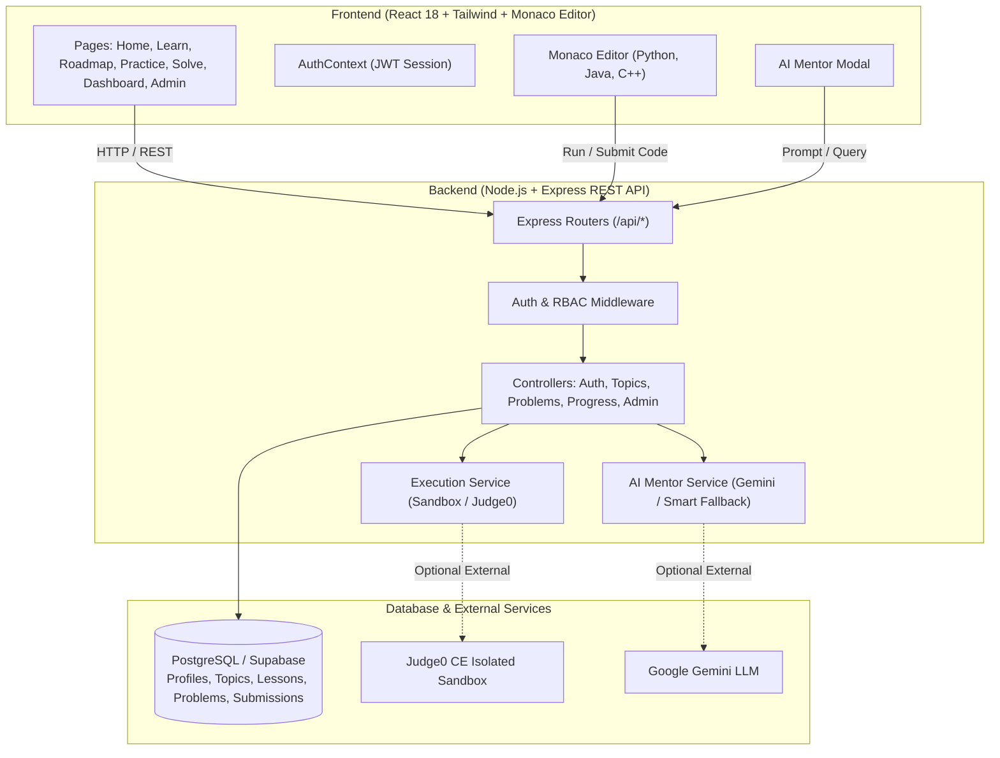
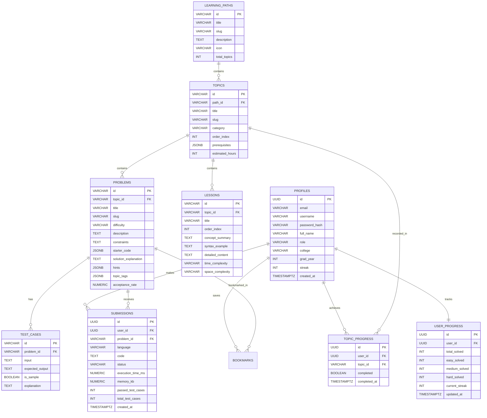

# 🚀 CODEPATH – FROM ZERO TO PLACEMENT READY

> **TAGLINE:** *Learn. Practice. Solve. Get Placement Ready.*

[](https://github.com/your-username/codepath/actions/workflows/ci.yml)
[](https://nodejs.org)
[](https://reactjs.org)
[](https://tailwindcss.com)
[](https://microsoft.github.io/monaco-editor/)
[](https://opensource.org/licenses/MIT)

---

## 📌 1. Project Overview

**CodePath** is a full-stack programming education and coding practice platform inspired by LeetCode, HackerRank, and structured DSA learning paths. It is engineered from the ground up to take aspiring software engineers from absolute programming fundamentals to cracking technical interview rounds and campus placement drives at top tech product companies.

The application features:
- **Language Foundations:** Step-by-step programming tracks for **Python, Java, and C++**.
- **15-Module Structured DSA Roadmap:** Covering foundational Arrays & Two Pointers up to advanced Dynamic Programming and Graphs.
- **LeetCode-Style Practice Studio:** Featuring the **Monaco Code Editor**, multi-language support (Python, Java, C++), test case execution, real-time feedback, and execution metrics.
- **AI Coding Mentor:** An intelligent Socratic coding assistant providing progressive hints, time/space complexity analysis, and concept guidance.
- **Placement Dashboard:** Real-time analytics tracking solved problem counts, difficulty breakdown (Easy/Medium/Hard), learning streaks, and custom topic recommendations.
- **Admin Control Center:** Role-Based Access Control (RBAC) allowing educators and administrators to manage problems, create test cases, and monitor platform performance.

---

## 💡 2. Problem Statement

University engineering students and career-transitioning developers often struggle with:
1. **Scattered Resources:** Jumping between ad-hoc tutorials, syntax cheatsheets, and fragmented question banks.
2. **Missing Progression:** Lack of a clear, dependency-ordered prerequisite roadmap that unlocks topics as mastery is demonstrated.
3. **Imtimidating Online Judges:** Getting stuck on compiler errors without progressive guidance or understanding time/space constraints.
4. **Placement Disconnect:** Not knowing which algorithms companies test most frequently during campus hiring drives.

**CodePath solves this** by unifying foundational syntax lessons, interactive coding challenges, structured prerequisite roadmaps, and intelligent mentorship into one cohesive, placement-focused ecosystem.

---

## ✨ 3. Core Features

### 🌐 A. Professional Homepage
- **Hero Section:** *"From Zero to Coding Hero"* with quick-start action triggers.
- **Curriculum Search:** Instantly query topics like "Dynamic Programming", "Sliding Window", or "Binary Search".
- **Path Previews & Statistics:** Transparent platform metrics showcasing challenge count, active students, and readiness scores.
- **Theme Engine:** Instant switching between high-contrast Dark Mode and clean Light Mode.

### 🔐 B. Authentication & Role-Based Access Control (RBAC)
- Student registration with campus affiliation and expected graduation year.
- JWT session management with secure Bearer authorization.
- Distinct roles: `student` (curriculum access, submissions, progress) and `admin` (question authoring, curation, analytics).
- Instant 1-click demo logins for immediate evaluation.

### 📊 C. Student Placement Dashboard
- **Aggregate Progress Metrics:** Total problems solved, accuracy percentage, and difficulty breakdown (Easy, Medium, Hard).
- **Interactive Recharts Visualization:** Donut chart breakdown showing algorithmic diversity.
- **Streak Tracker:** Dynamic day-counter with flame iconography to build consistent habits.
- **Recommended Next Topic:** Context-aware algorithm suggesting the next best topic based on completed prerequisites.
- **Submission History:** Real-time logs with execution speed, language tags, and status badges.

### 📚 D. Programming Learning Module
- **Python Path (10 Modules):** Introduction, Variables, Operators, Conditionals, Loops, Functions, Lists/Tuples, Dictionaries/Sets, OOP, Exception Handling.
- **Java Path (8 Modules):** Fundamentals, Data Types, Control Flow, Methods & Scope, Arrays & Strings, OOP Deep-Dive, Java Collections Framework, Exception Handling.
- **C++ Path (8 Modules):** Fundamentals, Variables, Conditionals & Loops, Functions, Arrays & Strings, Pointers & Memory Management, OOP, Standard Template Library (STL).

### 🗺️ E. 15-Topic DSA Placement Roadmap
- Dependency-based curriculum:
  1. Arrays & Two Pointers
  2. Strings & Frequency Tables
  3. Searching & Monotonic Reduction
  4. Sorting & Divide & Conquer
  5. Recursion & Backtracking
  6. Linked Lists & Fast-Slow Pointers
  7. Stacks & Monotonic Scans
  8. Queues & Sliding Windows
  9. Hashing & HashMaps
  10. Binary Trees & Traversals
  11. Binary Search Trees (BST)
  12. Heaps & Priority Queues
  13. Graphs, BFS/DFS & TopoSort
  14. Greedy Algorithms & Intervals
  15. Dynamic Programming (1D & 2D)
- Interactive locking/unlocking based on student completion status while preserving open access to review completed lessons.

### 💻 F. Online Code Editor & Execution Sandbox
- Powered by the **Monaco Editor** (the core engine of VS Code).
- Multi-language switching: **Python 3, Java (OpenJDK), C++ (GCC)**.
- Isolated Safe Execution Service: Executes test cases without exposing the host server process to arbitrary untrusted code.
- Judge0 CE integration ready (via `JUDGE0_API_KEY`).
- Test Case Inspection Panel: Displays Input, Expected Output, Actual Output, Console Diagnostics, Execution Time (ms), and Memory (KB).
- Confetti celebration animation upon receiving an **Accepted** verdict.

### 🤖 G. AI Coding Mentor
- Pedagogical coaching mode: Guides student intuition using hints and the Socratic method rather than spoiling full answers.
- One-click prompt shortcuts:
  - 💡 *Get a Hint*
  - ⏱️ *Complexity Breakdown*
  - 📘 *Explain Concept*
  - 🐞 *Check My Logic*
- Powered by **Google Gemini API** or **OpenAI API** when configured, with an active smart contextual DSA mentor fallback when running locally without API keys.

### 🛡️ H. Admin Management Studio
- Create, read, update, and delete coding problems with custom test cases.
- Configure starter templates, hints, tags, constraints, and solution editorials.
- Live student placement leaderboard tracking university rankings and top performers.

---

## 🛠️ 4. Technology Stack

| Layer | Technologies |
| :--- | :--- |
| **Frontend** | React 18, Vite, React Router 6, Tailwind CSS, Monaco Editor (`@monaco-editor/react`), Lucide Icons, Recharts, Canvas Confetti |
| **Backend** | Node.js, Express.js (REST APIs), CORS, Dotenv, JWT (`jsonwebtoken`), Bcrypt.js, UUID, Axios |
| **Database** | PostgreSQL / Supabase, Row-Level Security (RLS), In-memory seeded fallback store |
| **Testing** | Jest, Supertest |
| **CI / CD** | GitHub Actions (`.github/workflows/ci.yml`) |
| **Code Execution** | Isolated Local Sandbox Evaluator + Judge0 Remote API integration |
| **AI Integration** | Google Gemini API / OpenAI API + Contextual Fallback Engine |

---

## 🏛️ 5. System Architecture



---

## 🗄️ 6. Database Schema (PostgreSQL / Supabase)

The database schema is defined in [`backend/src/data/schema.sql`](file:///c:/Users/ashwi/Documents/codepath/backend/src/data/schema.sql) and includes:



---

## 📡 7. Backend REST API Documentation

### Authentication & Profile
- `POST /api/auth/register` - Create student account (returns JWT & profile).
- `POST /api/auth/login` - Authenticate student or admin.
- `GET /api/profile` - Retrieve current user profile and metrics.
- `PUT /api/profile` - Update profile information (college, graduation year, full name).

### Learning Paths & Topics
- `GET /api/topics/paths` - Retrieve all learning paths (Python, Java, C++, DSA).
- `GET /api/topics?pathId=...` - List topics in sequence.
- `GET /api/topics/:id` - Detailed topic view with lessons and problem lists.
- `GET /api/topics/:id/lessons` - Retrieve lessons for a topic.

### Practice Problems
- `GET /api/problems` - Filter problems by `difficulty`, `topicId`, `search`, and `tag`.
- `GET /api/problems/:id` - Get problem statement, starter code, and sample test cases.
- `GET /api/problems/topic/:topicId` - Retrieve all problems for a specific topic.

### Code Submissions & Execution
- `POST /api/submissions/run` - Execute code against sample test cases (isolated runner).
- `POST /api/submissions` - Submit code, execute against all test cases, update student records.
- `GET /api/submissions/history?problemId=...` - Retrieve past submissions for the authenticated user.

### Student Progress
- `GET /api/progress` - Student dashboard statistics and recommended next topic.
- `POST /api/progress/complete-topic` - Mark a topic as completed and unlock prerequisites.
- `GET /api/progress/leaderboard` - Campus student leaderboard.

### Admin Operations (Protected: `role === 'admin'`)
- `GET /api/admin/stats` - Platform health and engagement numbers.
- `POST /api/admin/problems` - Add a new coding challenge with test cases.
- `PUT /api/admin/problems/:id` - Update existing problem metadata.
- `DELETE /api/admin/problems/:id` - Delete problem and associated test cases.

### AI Mentor
- `POST /api/ai/ask` - Ask the AI mentor for hints, complexity analysis, or debugging advice.

---

## ⚙️ 8. Installation & Setup Instructions

### Prerequisites
- **Node.js**: v18.0.0 or higher
- **npm**: v9.0.0 or higher
- **Git**

### Step 1: Clone the Repository
```bash
git clone https://github.com/your-username/codepath.git
cd codepath
```

### Step 2: Install All Dependencies
```bash
# Install root, backend, and frontend dependencies in one command
npm run install:all
```
*Alternatively, install individually:*
```bash
cd backend && npm install
cd ../frontend && npm install
cd ..
```

### Step 3: Configure Environment Variables
Copy `.env.example` in the backend directory (or root):
```bash
cp .env.example backend/.env
```

Review configuration in `backend/.env`:
```env
PORT=5000
NODE_ENV=development
JWT_SECRET=codepath_jwt_secret_dev_key_2025_placement_ready

# Supabase / PostgreSQL (Optional - runs with in-memory database out of the box!)
DATABASE_URL=
SUPABASE_URL=
SUPABASE_SERVICE_ROLE_KEY=

# Optional LLM & Remote Judge Credentials
GEMINI_API_KEY=
OPENAI_API_KEY=
JUDGE0_API_KEY=
```

### Step 4: Run the Application
Start both backend and frontend concurrently:
```bash
npm run dev
```

Or run each service independently:
```bash
# In terminal 1 (Backend):
npm run dev:backend

# In terminal 2 (Frontend):
npm run dev:frontend
```

Open your browser at:
- **Frontend App:** [http://localhost:3000](http://localhost:3000)
- **Backend API:** [http://localhost:5000/api/health](http://localhost:5000/api/health)

---

## 🔑 9. Demo Accounts (Immediate Evaluation)

You can click the 1-click demo login buttons directly on the Login page or use the credentials below:

| Role | Email | Password | Access |
| :--- | :--- | :--- | :--- |
| **Demo Student** | `student@codepath.edu` | `student123` | Full student dashboard, problem solving, progress tracking |
| **Demo Admin** | `admin@codepath.edu` | `admin123` | Admin dashboard, question creation, editorial editing, leaderboard |

---

## 🧪 10. Automated Testing

CodePath includes a complete test suite written in **Jest** and **Supertest** testing:
- Student and Admin authentication & authorization.
- Topic and path retrieval.
- Problem filtering and details.
- Safe code execution & submission saving.
- Progress calculation and topic completions.
- Admin-only RBAC protection.

To run the backend test suite:
```bash
npm test
```

Expected result:
```
PASS tests/auth.test.js
PASS tests/topics.test.js
PASS tests/progress.test.js
PASS tests/admin.test.js
PASS tests/submissions.test.js
PASS tests/problems.test.js

Test Suites: 6 passed, 6 total
Tests:       23 passed, 23 total
```

---

## 🚀 11. Production Build & Deployment

### Build Frontend
```bash
npm run build
```
This produces an optimized, minified bundle in `frontend/dist/`.

### Deploy Frontend
Frontend can be deployed to **Vercel**, **Netlify**, or **Cloudflare Pages**:
- Build command: `npm run build`
- Output directory: `dist`
- Root directory: `frontend`

### Deploy Backend
Backend can be deployed to **Render**, **Railway**, **Fly.io**, or **AWS EC2**:
- Build command: `npm install`
- Start command: `node src/server.js`
- Environment variables: `PORT`, `JWT_SECRET`, `NODE_ENV=production`

### PostgreSQL / Supabase Setup
To connect a live Supabase or PostgreSQL database:
1. Create a Supabase project at [https://supabase.com](https://supabase.com).
2. Go to **SQL Editor** in Supabase and paste the contents of `backend/src/data/schema.sql`.
3. Set `DATABASE_URL` in your environment and run:
   ```bash
   npm run db:migrate
   ```

---

## 🔮 12. Future Enhancements

- [ ] **Peer Coding Rooms:** WebRTC-powered 1v1 mock interview rooms with collaborative Monaco editor syncing.
- [ ] **Company Tags:** Questions tagged specifically by company patterns (Google, Microsoft, Amazon, Atlassian).
- [ ] **Live Audio Mock Interviews:** AI interviewer utilizing audio streaming to conduct simulated behavioral and technical rounds.
- [ ] **Resume Scanner:** PDF resume parser evaluating project keywords against job requirements.

---

## 📄 License

This project is licensed under the [MIT License](LICENSE).
Built with ❤️ for placement-ready software engineers.
# Codepath

